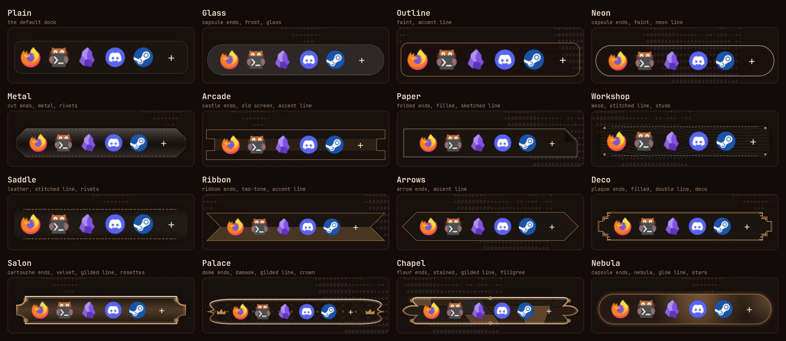
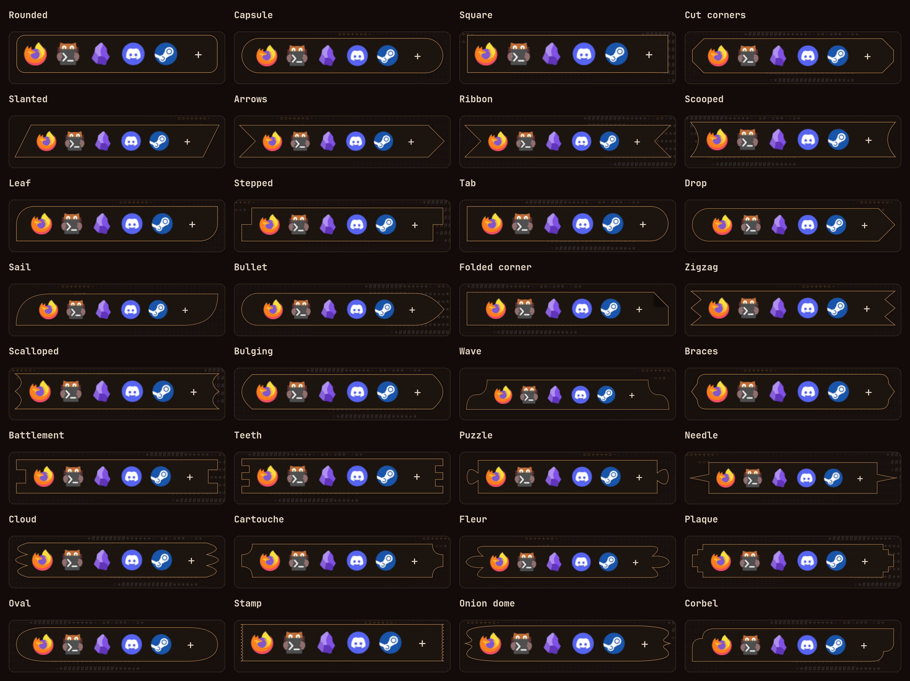
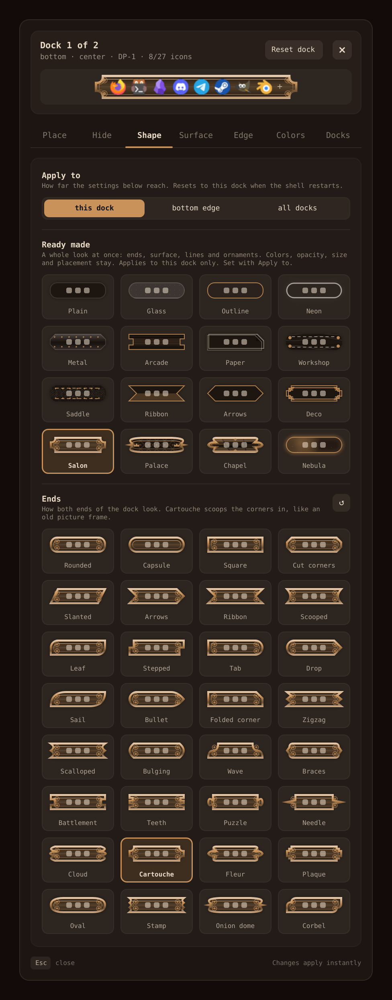
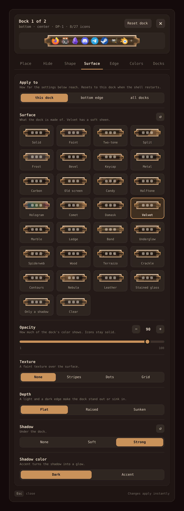
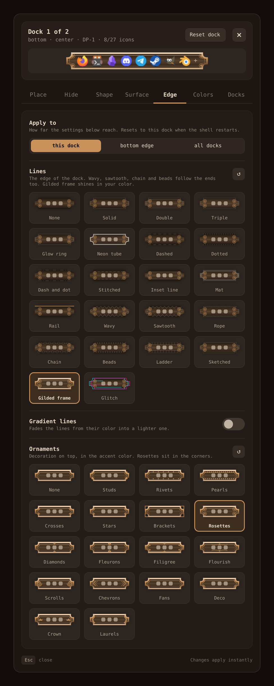
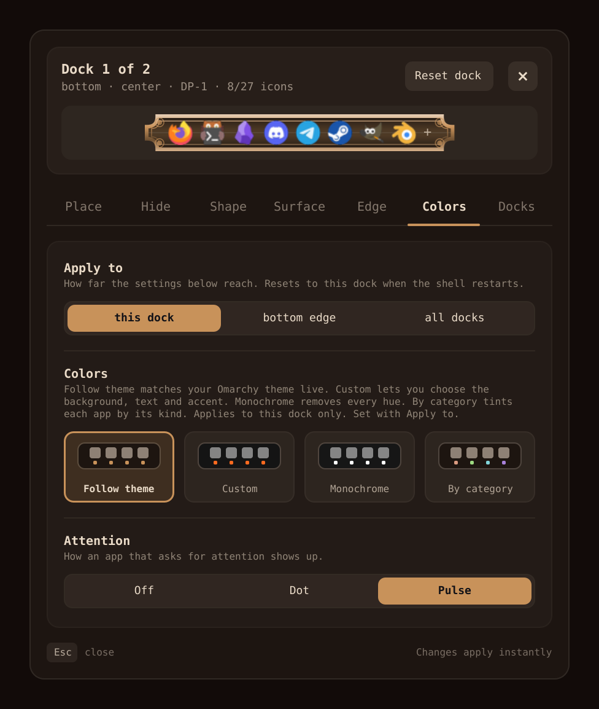

# Multi-Docks

Docks for [Omarchy](https://omarchy.org). As many as you want (well, twelve),
on any edge, on any monitor, each in a shape and finish of its own.


## Why

I wanted a dock on Omarchy. Then I wanted a second one on the left for tools.
Then one on my external monitor. Nothing out there did that properly, so this
does: every dock has its own apps, its own edge, its own look and its own way
of hiding.

Here's my setup: the main dock at the bottom with a live preview open and
Telegram asking for attention, a tools dock on the left, a custom-colored one
under the bar, and an auto-hidden one on the right that only shows its edge hint.


## What it does

- **Up to 12 docks**, 3 per edge, on any monitor. Docks sharing an edge split it
  evenly and never overlap.
- **Pin apps** with **+** and search, **drag icons** to reorder.
- **Click** launches the app, or cycles through its open windows if it has some.
- **Live previews** when you hover an app with windows. Click one to focus it.
- **Right-click menu** with *New window*, the app's own actions (like "New private
  window"), one *Focus* entry per window, close and remove.
- **Attention**: an app that asks for you (a chat message, a finished build, a
  terminal bell) gets a red dot and a soft glow, and its window is focused first
  when you click.
- **Auto-hide** with eight effects: slide, fade, glide, zoom, fold, bounce, pop and
  wave. Speed, delays, the reveal strip and an edge hint are all tunable.
- **Reserve space** so tiled windows stay out of the dock's way (and get the space
  back while an auto-hidden dock is away).
- **Plays nice with the Omarchy bar**: a dock on the same edge sits next to it,
  never on top of it.
- **Shapes and materials**: 32 kinds of ends (arrows, ribbon, cartouche, onion
  dome, ...), 30 surfaces (frost, metal, velvet, wood, stained glass, ...), 22
  edge lines, 18 ornaments and a shadow or glow. Or one of 16 ready made looks,
  with an undo.
- **Colors**: follow your theme, pick your own background/text/accent, monochrome,
  or a tint per app category.
- **Nothing extra to install.** No scripts, no sudo, no network.


## A look for every dock

Every dock has its own body, built from four parts you pick on their own:

- **Ends**: 32 kinds, from rounded and capsule to arrows, ribbon, braces, puzzle,
  cartouche, fleur and onion dome. Pointed ones point left, right or both ways.
- **Surface**: 30 materials, from faint and frost to brushed metal, carbon,
  marble, velvet, wood, leather and stained glass, solid, as a gradient or as glass.
- **Edge**: 22 lines, from a plain line to stitches, a chain, beads, a rope, a neon
  tube or a gilded frame. Wavy lines, chains and beads follow the ends all the way round.
- **Ornaments**: 18 kinds, studs, rivets, pearls, rosettes, scrolls, crowns,
  laurels, art deco corners and more, in your accent color.

Or start from one of 16 ready made looks and change what you like. **Undo the last
look** goes back one step. Every option in the settings is a little picture of your
own dock wearing it, in your colors, and **Apply to** can dress one dock, a whole
edge or all of them at once.



The icons always stay clear of the shape: pointed ends, and ornaments that sit
inside the ends (scrolls, crowns, laurels), move them in a little.

## Install

```bash
omarchy plugin add https://github.com/qempexe/omarchy-multi-docks.git --enable --yes
omarchy restart shell
```

It's a service, so there's nothing to add to the bar. A dock shows up at the
bottom on the first start.

Needs Omarchy 4 with Hyprland (it's Hyprland only).

### Try it

1. Click **+** on the new dock and pin a few apps.
2. Open one and hover its icon: live preview.
3. Drag an icon somewhere else.
4. Right-click empty dock space -> **Hide** -> turn on **Auto-hide** and pick an
   effect. Move the mouse away, then touch the edge.
5. **Shape** tab -> pick a ready made look, then try other ends, a surface on
   **Surface** or a line and an ornament on **Edge**.
6. **Docks** tab -> **Add dock** to put a second one on another edge (or another
   monitor with **Monitor**).

## Using it

| Do | How |
| --- | --- |
| Pin an app | **+**, search, click |
| Reorder | drag an icon along the dock |
| Launch / cycle windows | click the icon (each click goes to the next window, the one asking for attention first) |
| Previews | hover an app with windows, click a preview |
| App menu | right-click an icon |
| Dock settings | right-click empty dock space, or right-click **+** |
| Bring back a hidden dock | touch the strip on the edge |
| Settings tabs | click, or **Alt+Left** / **Alt+Right** |
| Numbers | drag, **-** / **+**, or scroll (**Shift** = steps of 5) |
| Undo a setting | the **↺** next to it |

A dot under an icon means the app has windows open. When a dock is full, **+**
becomes **⋯** and opens the settings.

### The app menu

| Entry | Does |
| --- | --- |
| New window | starts a new instance |
| App actions | whatever the app's desktop entry offers |
| Focus: *title* | one per open window |
| Close window(s) | closes all of that app's windows |
| Remove from dock | unpins it |

## Settings

Right-click empty space on a dock to open its settings. Everything applies right
away and is saved in `~/.config/omarchy-dock/config.json`. Seven tabs: **Place**,
**Hide**, **Shape**, **Surface**, **Edge**, **Colors** and **Docks**.


At the top you see which dock it is, where it sits and a live preview of it, drawn
in the dock's own shape (it scrolls when you have lots of icons). **Reset dock** puts everything back to the
defaults but keeps your apps and where the dock is. Click it twice.


### Place

| Setting | Default | |
| --- | --- | --- |
| Monitor | primary | which screen (only shown with more than one). Unplug it and the dock moves to the primary until it's back |
| Edge | bottom | bottom, top, left, right |
| Position | center | start, center or end of the edge |
| Full length | off | stretch across the whole edge |
| Margin | 6 | gap to the edge (or the bar), 0-64 px, shared by every dock on that edge |
| Icon size | 44 | 1-64 px, always this dock only |

<p align="center"></p>

### Hide

| Setting | Default | |
| --- | --- | --- |
| Auto-hide | off | hide until the mouse touches the edge |
| Reserve space | on | keep tiled windows out of the way (shared per edge) |
| Apply to | this dock | this dock, its edge, or all docks. Not saved |
| Effect | slide | slide, fade, glide, zoom, fold, bounce, pop, wave |
| Speed | 180 | ms, 60-800 |
| Show delay | 0 | ms the mouse has to stay on the edge, 0-1000 |
| Hide delay | 450 | ms it stays after you leave, 0-2000 |
| Reveal strip | 3 | px of edge that brings it back, 1-12 |
| Edge hint | on | a small line on the edge while hidden (turns the attention color when an app asks) |

The effect settings are dimmed while auto-hide is off, since they do nothing then.
Here's every effect frame by frame, same timing the dock uses:


<p align="center"></p>

### Shape

| Setting | Default | |
| --- | --- | --- |
| Apply to | this dock | same as on Hide |
| Ready made | | 16 complete looks: ends, surface, lines and ornaments in one click. **Undo the last look** goes back one step |
| Ends | rounded | 32 kinds, each tile drawn the way your dock would look |
| Pointing | right | right, left or both ways, for ends that point and surfaces that lean (on a side dock, right means down) |
| Square corners | none | keep the corners on the screen edge side or the windows side square (rounded and capsule ends) |
| Corner radius | 16 | 1-64 px, for rounded ends |

Because pointed ends and some ornaments move the icons in, a full dock can
refuse one of them until you remove an icon or pick a smaller icon size.



<p align="center"></p>

### Surface

| Setting | Default | |
| --- | --- | --- |
| Surface | solid | 30 kinds, from faint and frost to metal, marble, velvet and stained glass |
| Opacity | 90 | how much of the dock's color shows, 1-100 % |
| Fill | solid | solid, gradient or glass (for surfaces that take it) |
| Gradient into | accent | accent, lighter or darker |
| Gradient across | off | fade from the screen edge toward the windows instead of end to end |
| Texture | none | stripes, dots or grid |
| Depth | flat | raised or sunken |
| Shadow | soft | none, soft or strong |
| Shadow color | dark | dark, or the accent for a glow |

<p align="center"></p>

### Edge

| Setting | Default | |
| --- | --- | --- |
| Lines | solid | 22 kinds. Wavy, sawtooth, chain and beads go all the way round the ends too |
| Line color | subtle | subtle, text color or accent. Accent also outlines the popups and this panel |
| Line width | 1 | 1-4 px |
| Rail on | windows side | windows side, screen edge or both (for Rail) |
| Gradient lines | off | fade the lines into a lighter shade |
| Ornaments | none | 18 kinds, in the accent color |

<p align="center"></p>

### Colors

| Setting | Default | |
| --- | --- | --- |
| Apply to | this dock | same as on Hide |
| Colors | theme | follow theme, custom, monochrome, by category |
| Custom colors | #141414 / #e0e0e0 / #ff6a1f | background, text, accent (swatch or hex) |
| Attention | pulse | off, dot, or pulse (dot + glow + an outline that pulses) |

The same dock in each color mode:


<p align="center"></p>

### Docks

All your docks in a list (this one highlighted), **Add dock** (goes on the edge
with the fewest docks, as long as there's room), **Remove this dock** (click twice,
the last one can't go) and what bar detection found on this monitor.

<p align="center"></p>

### Attention on Omarchy

Omarchy focuses a window as soon as it asks for attention, so it never becomes
"urgent" and the dock has nothing to show. For the apps you want the indicator
on, add a rule at the bottom of `~/.config/hypr/hyprland.lua` with their window
class:

```lua
o.window("foot", { focus_on_activate = false })
```

Then `hyprctl reload`. You can find the class with `hyprctl clients | grep class`.

### The config file

```json
{
  "docks": [
    {
      "apps": ["firefox", "kitty"],
      "edge": "bottom",
      "align": "center",
      "stretch": false,
      "autohide": false,
      "reserve": true,
      "style": "theme",
      "size": 44,
      "opacity": 90,
      "radius": 16,
      "monitor": "",
      "attention": "pulse",
      "hideEffect": "slide",
      "hideSpeed": 180,
      "showDelay": 0,
      "hideDelay": 450,
      "revealStrip": 3,
      "edgeHint": true,
      "customBg": "#141414",
      "customFg": "#e0e0e0",
      "accentColor": "#ff6a1f",
      "ends": "rounded",
      "pointing": "right",
      "flatSide": "none",
      "surface": "filled",
      "fill": "solid",
      "gradientTo": "accent",
      "gradientAcross": false,
      "pattern": "none",
      "depth": "flat",
      "lines": "solid",
      "border": "subtle",
      "borderWidth": 1,
      "railSide": "windows",
      "outlineGradient": false,
      "ornaments": "none",
      "shadow": "soft",
      "shadowColor": "dark"
    }
  ],
  "margins": { "top": 6, "bottom": 6, "left": 6, "right": 6 }
}
```

`apps` are desktop entry ids in dock order. Anything missing or weird falls back
to the default. A config from before 2.1.0 with `"outline": true` gets an accent
line, so the dock looks the same after the update. It's read at startup, so restart the shell after editing by hand.

## Things to know

- **Hyprland only.**
- Only pinned apps show up. It's a launcher that knows about windows, not a full taskbar.
- Apps are matched to windows by their id. An app whose window id doesn't match
  its desktop entry won't get a dot or previews.
- Margins are per edge, not per monitor yet. Monitors are matched by name (`DP-1`),
  which can change if you swap ports.
- Reserve space + auto-hide together means tiled windows resize every time the
  dock shows or hides. Pick one if that bugs you.
- Bar detection looks for a layer named "bar" or a thin strip on an edge, every
  few seconds. If it misses yours, raise the margin.
- Attention is per app, not per window, and needs the rule above on Omarchy.
- Effects other than slide cost a bit of GPU while they play.
- The dock's body is drawn once and again only when its look, size or colors
  change. The attention pulse redraws nothing, it only fades.
- Undo for looks lasts until the shell restarts.
- The hex field only takes typing, no paste.
- Mostly mouse driven, the dock itself has no keyboard navigation.
- Tested mostly on my own setups, so unusual multi-monitor layouts might need fixes.

## Where things are

- `~/.config/omarchy-dock/config.json`: your docks
- `~/.cache/omarchy-dock/`: what `hyprctl` reported about the bar and urgent
  windows (private to you)

It only runs `hyprctl`, reads your theme, desktop entries and open windows, and
never touches Omarchy's own config. Previews are only captured while they're open.

```
qml/
├── Service.qml       config, theme, bar detection, layout
├── dock/             DockWindow, Spacer (reserved space), SearchField
├── settings/         SettingsPanel, SettingRow
└── js/
    ├── Effects.js    the hide effect math
    ├── Style.js      the look settings, the ready made looks, room for the ends
    ├── Paint.js      draws a dock's body
    ├── Trace.js      walks a shape's outline (lines and beads that follow the ends)
    └── parts/        Ends, Surfaces, Lines, Ornaments: one entry per kind, with its drawing
tests/test_style.js   node tests/test_style.js
```

## Updating

```bash
omarchy plugin update io.github.qempexe.multi-docks
omarchy restart shell
```

The restart matters, otherwise you're still running the old version.

## Uninstall

```bash
omarchy plugin remove io.github.qempexe.multi-docks
omarchy restart shell
rm -rf ~/.config/omarchy-dock ~/.cache/omarchy-dock   # only if you want your docks gone too
```

## License

[MIT](LICENSE)
