# Multi-Docks

An [Omarchy](https://omarchy.org) shell service that gives you up to twelve independent docks: pinned apps, drag-to-reorder icons, live window previews, right-click app menus, auto-hide with eight hide effects, reserved screen space, per-edge margins and theme-aware colors.

A dock appears at the bottom of the screen the first time you enable the plugin. Click **+** to pin apps, right-click empty dock space to open its settings panel, and add more docks on any edge when one is not enough.

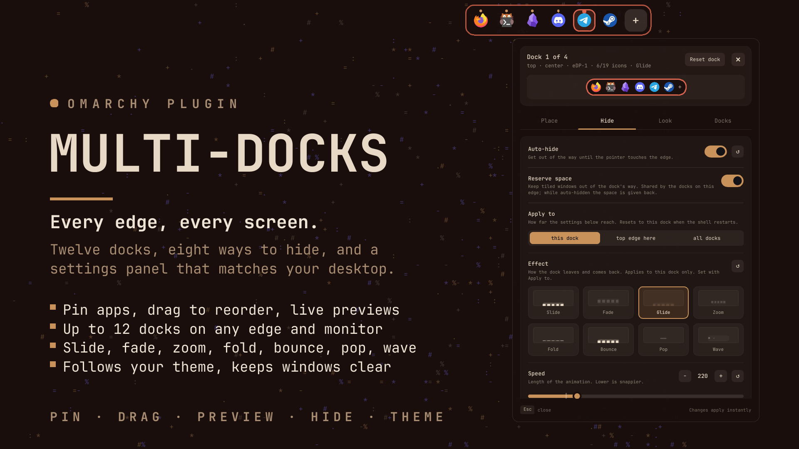

Four docks at once: the main dock on the bottom with a live window preview open and Telegram asking for attention, a tools dock on the left, a Custom-colored dock with the window outline under the Omarchy bar, and an auto-hidden dock on the right that only shows its red edge hint.

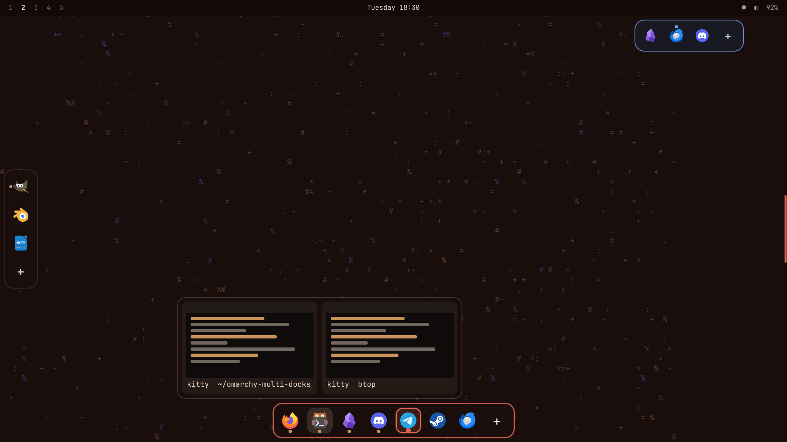

## Features

- **Up to 12 docks, 3 per edge**: put docks on the bottom, top, left and right edges at the same time. Docks on the same edge of the same monitor share it in equal slots, so they never overlap.
- **Multi-monitor**: choose a monitor for each dock. Every monitor has its own edges, slots, Omarchy bar detection and reserved space, so a bottom dock on your laptop screen and another on an external display do not affect each other.
- **Pinned apps from desktop entries**: click **+**, search by name, click an app. Apps already pinned to that dock are hidden from the list, and the list is sorted alphabetically.
- **Drag to reorder**: press an icon and drag along the dock. The other icons slide out of the way while you drag and the new order is saved when you release.
- **Smart click**: a click launches the app if it has no windows, otherwise it focuses the next window of that app, so repeated clicks cycle through all of them.
- **Live window previews**: hover an icon that has open windows to see a live capture of each window with its title. Click a card to focus that exact window. The preview stays open while your pointer is on it.
- **Attention indicator**: when an app asks for attention (a chat message, a finished build, a terminal bell), its icon gets a red dot and a soft pulsing glow, and the dock border pulses too, so it is visible even on an auto-hidden dock's edge strip. Click the icon and the window that asked for attention is focused first. It clears on its own once that window is focused.
- **Running indicator**: a small dot in your accent color marks every app that has open windows. It sits on the side of the icon facing the screen edge, so it follows the dock to any edge.
- **Right-click app menu**: *New window*, the app's own desktop actions (for example "New private window"), one *Focus* entry per open window, *Close window(s)* and *Remove from dock*.
- **Auto-hide**: the dock gets out of the way and comes back when the pointer touches a thin strip on the edge. It stays open while a menu or popup is open and lingers after the pointer leaves, so it never snaps shut under your cursor.
- **Eight hide effects**: *Slide*, *Fade*, *Glide* (slide and fade), *Zoom* (shrinks onto the edge), *Fold* (squashes flat against the edge), *Bounce* (springs back past its spot), *Pop* (grows from its center) and *Wave* (the background fades and the icons pop in one after another, and leave in reverse). Each effect is previewed live in the settings.
- **Tunable hiding**: animation speed, a show delay so brushing past the edge does nothing, a hide delay, the thickness of the reveal strip, and an optional edge hint: a small line that marks where a hidden dock is and turns the attention color when an app asks for you.
- **Reserve space**: push tiled windows out of the dock's way. Combined with auto-hide, the space is held only while the dock is visible and given back the moment it hides.
- **Per-edge margin**: set the gap between the dock and the screen edge from 0 to 64 px. One value per edge, shared by every dock on that edge.
- **Sits above the Omarchy bar**: when a dock shares an edge with the Omarchy bar, it is placed on the inner side of the bar instead of covering it. Docks on neighbouring edges start after the bar as well.
- **Four color modes**: *Follow theme* matches the active Omarchy theme live, *Custom* lets you choose the background, text and accent yourself (24 swatches or any hex), *Monochrome* removes every hue, and *By category* gives each app its own tint from its desktop category, used for its running dot and hover. Each dock keeps its own choice, and the settings panel always uses its dock's colors.
- **Window outline**: the edge of the dock, its popups and its settings is a plain line by default. Turn the outline on to draw it in your accent color.
- **Apply to**: apply colors, attention, opacity, corner radius, window outline and every hide-effect setting to one dock, to every dock on its edge, or to all docks in one click.
- **Settings panel**: a header with a live preview of the dock, tabs for *Place*, *Hide*, *Look* and *Docks*, a hint under every setting, a reset arrow on anything changed from its default, and *Reset dock* (asks twice).
- **Full styling per dock**: icon size, background opacity and corner radius each have a slider with - / + buttons and a notch at the default.
- **Flexible placement**: choose the edge, align the dock to the start, center or end of that edge, or stretch it to the full length.
- **Click-through margins**: only the dock itself catches the mouse. The margin, the empty part of the window and the hidden dock do not block clicks on the windows beneath.
- **Layout guard**: if a change would not leave enough room for the icons (smaller screen, bigger icons, more docks), the plugin refuses it and tells you why instead of clipping icons.
- **No extra packages**: it only needs what Omarchy 4 already ships (see Requirements). No helper scripts, no install hooks, no network and no sudo.

## Requirements

- Omarchy 4 (Quattro) with shell plugin support.
- Hyprland, with `hyprctl` on your `PATH` (it ships with Hyprland). It is used to find the Omarchy bar and the dock windows rely on Hyprland-specific Quickshell modules.
- Quickshell, which comes with Omarchy 4.

Nothing else needs to be installed.

## Install

```bash
omarchy plugin add https://github.com/qempexe/omarchy-multi-docks.git --enable --yes
```

Or by hand: copy this directory to `~/.config/omarchy/plugins/io.github.qempexe.multi-docks/` (the folder name must match the plugin id), then:

```bash
omarchy-shell shell rescanPlugins
omarchy plugin enable io.github.qempexe.multi-docks
```

This plugin is a service, so there is nothing to add to your bar layout. Restart the shell once:

```bash
omarchy restart shell
```

### See it work in 2 minutes

1. A starter dock appears at the bottom. Click **+** and pin two or three apps.
2. Open one of them, then hover its icon to see the live preview.
3. Drag an icon to a new position.
4. Right-click empty dock space, open the **Hide** tab, turn **Auto-hide** on and pick an effect. Move the pointer away, then touch the screen edge to bring it back.
5. Open the settings again and use **Add dock** on the **Docks** tab to create a second dock on another edge. With an external monitor connected, use **Monitor** to move a dock to it.

## Usage

| Action | How |
| --- | --- |
| Pin an app | Click **+**, search, click an app |
| Reorder | Press and drag an icon along the dock, release to drop |
| Launch an app | Click its icon when it has no windows |
| Focus / cycle windows | Click an icon of an app that has windows. Each click moves to the next window. If one window is asking for attention, it is focused first |
| Window previews | Hover an icon that has open windows, click a preview to focus that window |
| App menu | Right-click an icon |
| Open dock settings | Right-click empty dock space or right-click **+** |
| Reveal an auto-hidden dock | Move the pointer onto the strip left on the screen edge |
| Close a popup | Click anywhere outside it, or press **Esc** in the settings |
| Switch settings tabs | Click a tab, or **Alt+Left** / **Alt+Right** |
| Change a number | Drag the slider, click **-** / **+**, or scroll over it (hold **Shift** for steps of 5) |
| Undo one setting | Click the **↺** arrow next to it (shown only when it differs from the default) |

A dot on an icon means the app has open windows. When a dock is full, **+** turns into **⋯** and opens the settings instead.

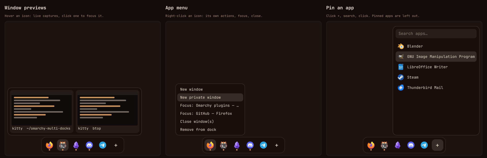

### The app menu

| Entry | What it does |
| --- | --- |
| New window | Starts a fresh instance of the app |
| App actions | Every action defined in the app's desktop entry |
| Focus: *title* | One entry per open window, focuses that window |
| Close window(s) | Closes all windows of the app |
| Remove from dock | Unpins the app from this dock |

## Settings

Right-click empty dock space (or right-click **+**) to open the settings of that dock. Everything applies instantly and is saved to `~/.config/omarchy-dock/config.json`.

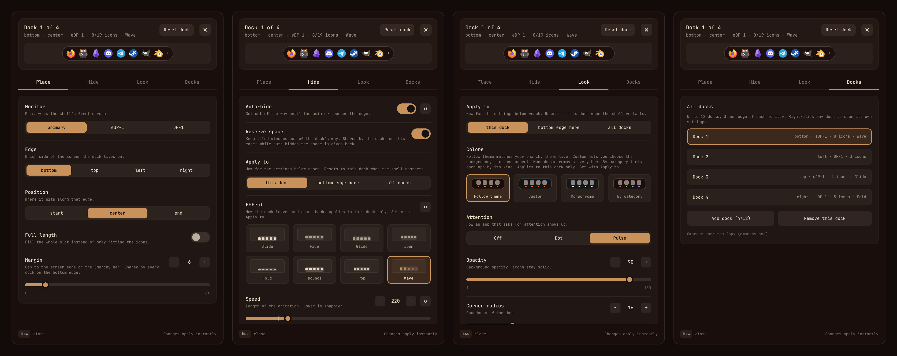

The panel has a header with the dock's name, where it sits, how many icons it holds and a live preview of it, then four tabs. When the dock holds more icons than the preview fits, the preview scrolls sideways with the mouse wheel, by dragging, or with the bar under it. **Reset dock** puts every setting of this dock back to its default and keeps its apps, edge, position and monitor; click it twice to confirm.

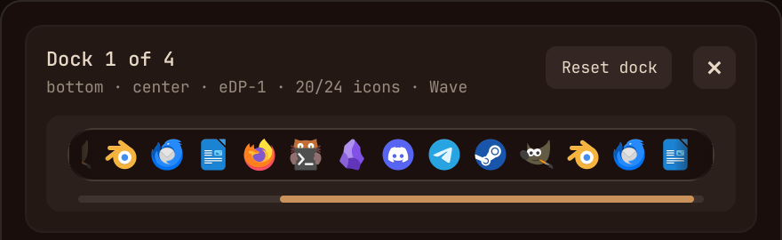

### Place

| Setting | File key | Default | Meaning |
| --- | --- | --- | --- |
| Monitor | `monitor` | primary | `primary` (the shell's first screen) or the name of a connected monitor such as `DP-1`. Only shown when more than one monitor is connected. If the chosen monitor is unplugged, the dock moves to the primary screen until it comes back |
| Edge | `edge` | bottom | `bottom`, `top`, `left` or `right` |
| Position | `align` | center | `start`, `center` or `end` of that edge (inside the dock's slot) |
| Full length | `stretch` | off | Stretch the dock across the whole slot instead of fitting only the icons |
| Margin | `margins.<edge>` | 6 | Gap in px between the screen edge (or the Omarchy bar) and the docks, 0 to 64. Shared by every dock on that edge |

<p align="center">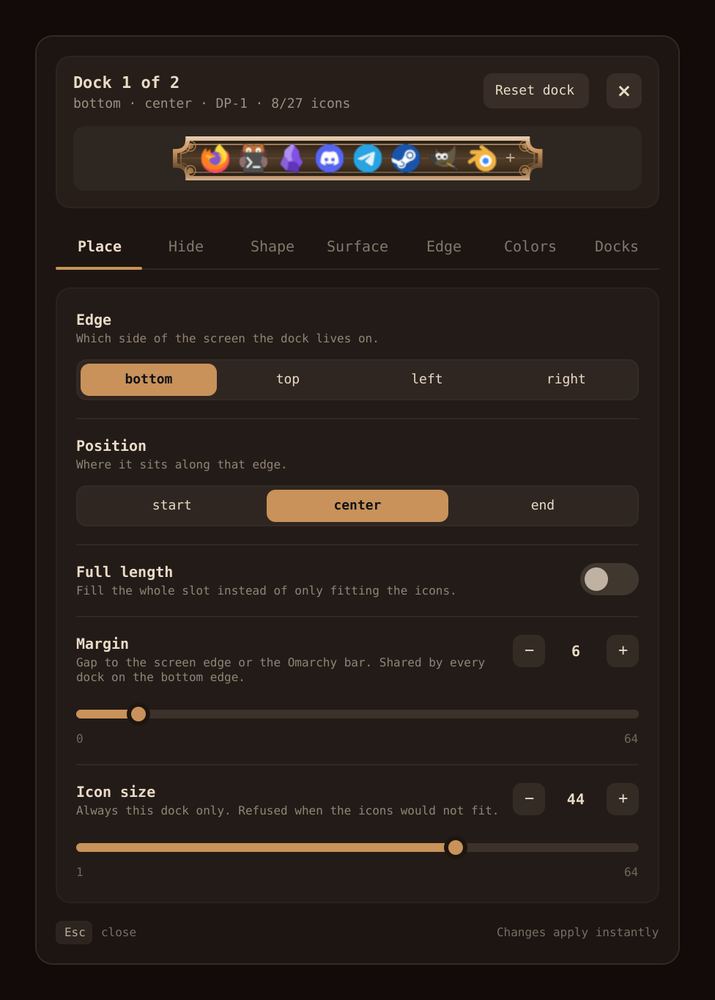</p>

### Hide

| Setting | File key | Default | Meaning |
| --- | --- | --- | --- |
| Auto-hide | `autohide` | off | Hide until the pointer touches the reveal strip on the edge |
| Reserve space | `reserve` | on | Keep tiled windows out of the dock's area. Shared by every dock on that edge. With auto-hide on, the space is held only while the dock is visible |
| Apply to | n/a | this dock | How far the settings below reach: `this dock`, `<edge> edge` or `all docks`. Not saved, it resets when the shell restarts |
| Effect | `hideEffect` | slide | `slide`, `fade`, `glide`, `zoom`, `fold`, `bounce`, `pop` or `wave` |
| Speed | `hideSpeed` | 180 | Animation length in ms, 60 to 800 |
| Show delay | `showDelay` | 0 | How long the pointer has to stay on the edge before the dock appears, in ms, 0 to 1000 |
| Hide delay | `hideDelay` | 450 | How long the dock stays after the pointer leaves, in ms, 0 to 2000 |
| Reveal strip | `revealStrip` | 3 | Thickness in px of the edge zone that brings the dock back, 1 to 12. Sliding effects leave this much of the dock showing |
| Edge hint | `edgeHint` | on | A small line on the edge while the dock is hidden. It takes the attention color (and pulses with `pulse`) when an app asks for attention |

Effect, speed, delays, strip and hint are dimmed while auto-hide is off, because they do nothing then.

Every effect while the dock hides, at the same moments in time and with the same easing curves the dock uses (showing runs the same frames backwards):

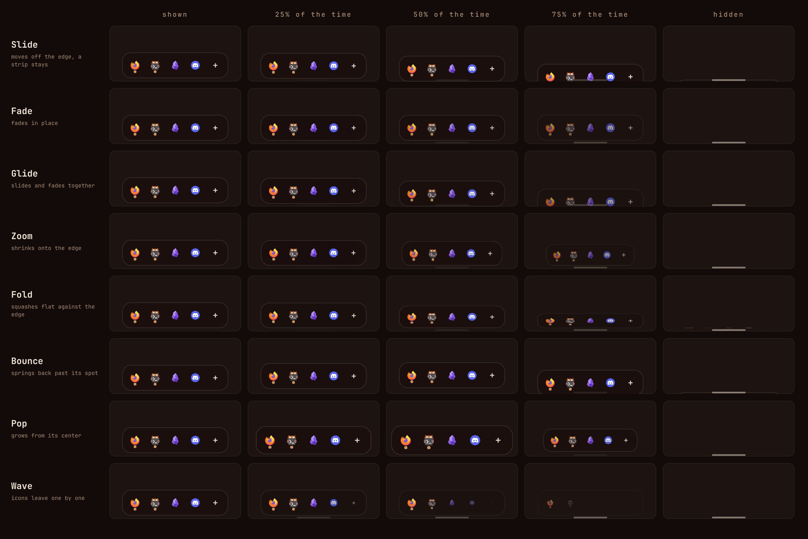

<p align="center">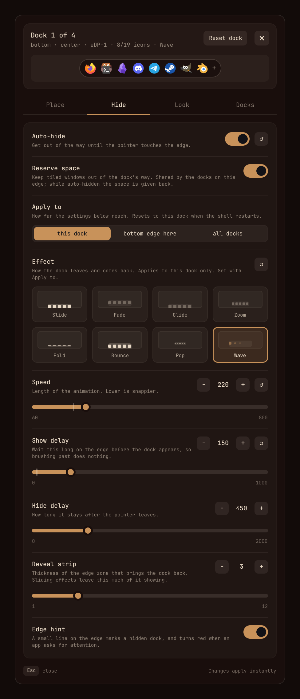</p>

### Look

| Setting | File key | Default | Meaning |
| --- | --- | --- | --- |
| Apply to | n/a | this dock | Same switch as on the Hide tab |
| Colors | `style` | theme | `theme` (Follow theme) follows the active Omarchy theme, `custom` (Custom) uses your own background, text and accent, `monochrome` is fixed grey and white, `category` (By category) tints each app by its desktop category. The settings panel uses the same colors as its dock |
| Custom colors | `customBg`, `customFg`, `accentColor` | #141414, #e0e0e0, #ff6a1f | Only with Custom. Choose *Background*, *Text* or *Accent*, then pick a swatch or type a hex such as `#7aa2f7` and press Enter. The arrow resets all three. The attention color stays the theme's |
| Attention | `attention` | pulse | What an app that asks for attention looks like (see *Attention on Omarchy* below for the one-line Hyprland rule it needs): `off`, `dot` (red dot only) or `pulse` (dot, glowing icon and pulsing border) |
| Opacity | `opacity` | 90 | Dock background opacity in percent, 1 to 100 |
| Corner radius | `radius` | 16 | Roundness of the dock in px, 1 to 64 |
| Window outline | `outline` | off | Draw the edge of the dock, its popups (previews, app menu, app picker) and the settings panel in the accent color. Off keeps a plain neutral line |
| Icon size | `size` | 44 | Icon size in px, 1 to 64. Always this dock only |

The same dock in each color mode (the hovered icon shows how *By category* tints the hover too):

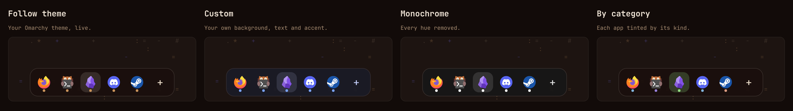

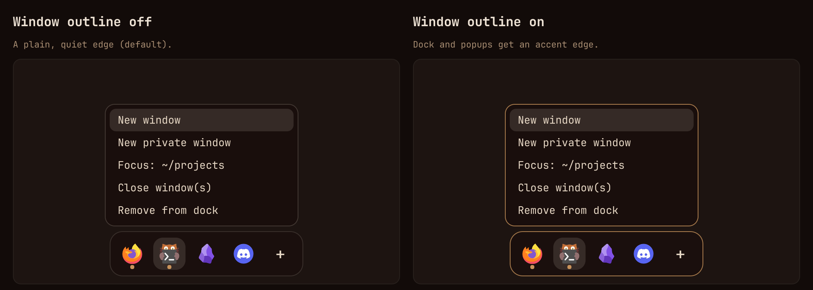

<p align="center">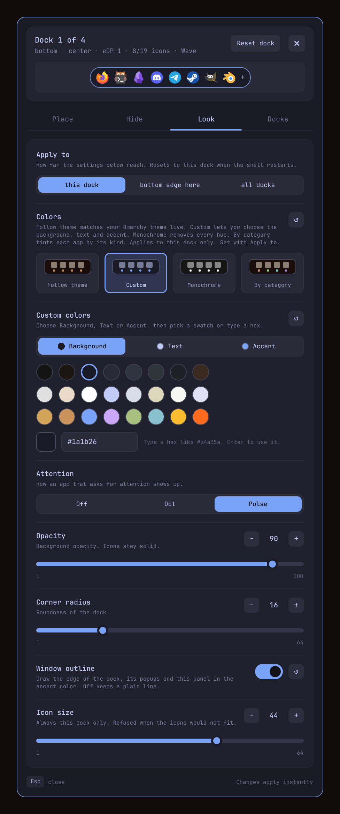</p>

### Docks

| Control | What it does |
| --- | --- |
| Dock list | Every dock with its edge, monitor, icon count and hide effect. The one you opened is highlighted |
| Add dock (n/12) | Creates a new empty dock on the same monitor, on the edge with the fewest docks, as long as there is room |
| Remove this dock | Deletes this dock after a second click. The last remaining dock cannot be removed |
| Omarchy bar | What bar detection found on this monitor |

<p align="center">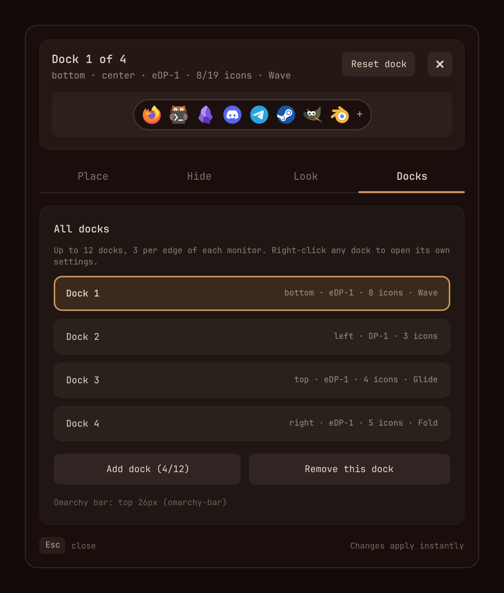</p>

### Attention on Omarchy

Omarchy's Hyprland defaults set `focus_on_activate = true`. That makes a window that asks for attention jump to the front and take keyboard focus right away, so it never gets the "urgent" mark that the attention indicator reacts to. Only apps with their own rule (Telegram, for example) stay urgent.

To get the indicator for an app, tell Hyprland not to focus it when it asks. Add a line like this at the bottom of `~/.config/hypr/hyprland.lua`, using the app's window class:

```lua
o.window("foot", { focus_on_activate = false })
```

The rule takes effect after a Hyprland reload (`hyprctl reload`). Find an app's class with `hyprctl clients | grep class`. Apps without such a rule keep Omarchy's behaviour and simply come to the front.

### Config file

```json
{
  "docks": [
    {
      "apps": ["firefox", "kitty"],
      "edge": "bottom",
      "align": "center",
      "stretch": false,
      "autohide": false,
      "reserve": true,
      "style": "theme",
      "size": 44,
      "opacity": 90,
      "radius": 16,
      "monitor": "",
      "attention": "pulse",
      "hideEffect": "slide",
      "hideSpeed": 180,
      "showDelay": 0,
      "hideDelay": 450,
      "revealStrip": 3,
      "edgeHint": true,
      "outline": false,
      "customBg": "#141414",
      "customFg": "#e0e0e0",
      "accentColor": "#ff6a1f"
    }
  ],
  "margins": { "top": 6, "bottom": 6, "left": 6, "right": 6 }
}
```

- `apps` are desktop entry ids, in dock order.
- Missing or unknown values fall back to the defaults above, and every number is clamped to its range.
- The file is read when the shell starts. If you edit it by hand, run `omarchy restart shell` afterwards.

## Advantages

### Everyday use

- **Fast to set up**: a working dock exists from the first start, and pinning an app is two clicks.
- **Everything in one place**: pinning, reordering, previews, menus and settings all live on the dock itself, with no separate settings app.
- **Instant feedback**: every setting applies the moment you change it, no restart and no apply button.
- **You notice what needs you**: urgent apps are visible at a glance, even in the corner of your eye, without notification popups. The dot, the glowing icon and the highlighted preview card all point at the right window.
- **Window-aware, not just a launcher**: dots, focus cycling, per-window focus and close make it useful for switching, not only for starting apps.
- **Previews you can trust**: they are live captures of the real window, not static icons.
- **Menus that match the app**: the right-click menu includes the actions the app itself declares, so you get its "new private window" and similar shortcuts for free.
- **No accidental closes**: drag, click and right-click are separate gestures, and a drag needs a deliberate move before it starts.

### Layout and flexibility

- **Four edges at once**: a bottom dock for daily apps, a left dock for tools, a top dock for something else, all at the same time.
- **One dock per screen, or many**: put a different dock on each monitor, with its own apps and settings, or keep everything on one screen.
- **Survives unplugging**: if a monitor disappears, its docks move to the primary screen instead of vanishing, and go back when it returns.
- **Many docks, one plugin**: up to 12 docks, each with its own apps, size, colors and behaviour.
- **Per-dock behaviour**: one dock can auto-hide while another stays fixed and reserves space.
- **Per-edge margins**: set the spacing once for an edge and every dock there follows it.
- **Edge-wide look controls**: restyle all docks on an edge, or all docks, with one click instead of touching each one.
- **Aligns where you want it**: start, center or end of the edge, or full length for a classic panel look.
- **Docks cooperate**: slots, bar offsets and neighbouring docks are calculated together, so docks on different edges avoid each other's corners.
- **Safe changes**: the plugin refuses settings that would make icons overflow and explains what to change.

### Omarchy integration

- **Follows your theme**: switch the Omarchy theme and every `theme` dock changes color within about a second.
- **Respects the bar**: docks are placed above the Omarchy bar on its edge instead of covering it, and the detected bar is reported in the settings so you can see what the plugin found.
- **Real reserved space**: other windows are pushed out of the dock's way using the compositor's own mechanism, not by faking it.
- **Auto-hide that gives space back**: with reserve and auto-hide both on, tiled windows use the full screen while the dock is hidden and make room only when it shows.
- **Auto-hide that really reaches the edge**: the reveal strip sits on the very edge even when you use a margin, and the space between the strip and the dock counts as the dock, so it never closes while you move onto it.
- **Click-through design**: margins, gaps between docks and hidden docks never swallow clicks meant for windows underneath.

### Safety and maintenance

- **Tiny footprint**: it reads your theme file and desktop entries, writes one config file and one cache file, and nothing else.
- **No network, no sudo, no install hooks, no extra packages.**
- **Plain-text rendering**: window titles, app names, desktop action names and bar layer names come from other programs, so every label in the dock is drawn as plain text. A window titled with HTML or an image tag is shown literally and can never make the shell fetch anything.
- **Plain text config**: one readable JSON file that is easy to back up, version or copy to another machine.
- **Small, readable code**: a handful of QML files, easy to audit before enabling and easy to modify.
- **Clean removal**: removing the plugin leaves nothing running, and the optional cleanup is two commands.

## Disadvantages

- **Hyprland only**: previews, focus handling and bar detection use Hyprland-specific parts of Quickshell and `hyprctl`. It will not work on another compositor.
- **Monitor settings are partly shared**: margins are one value per edge for all monitors, and the "Apply to" edge option affects the docks on that edge of the same monitor only. There is no per-monitor margin yet.
- **Monitors are matched by name**: names like `DP-1` can change when you swap cables or ports. A dock whose monitor name no longer exists sits on the primary screen until you pick a monitor again.
- **Limited multi-monitor testing**: this was written from the code and checked with simulated layouts, so unusual setups (mixed scaling, rotated screens, hot-plugging many monitors) may need fixes.
- **Pinned apps only**: apps that are running but not pinned do not appear in the dock. It is a launcher with window awareness, not a full task switcher.
- **Desktop entries only**: only apps that have a desktop entry can be pinned.
- **App matching can miss**: windows are matched to icons by app id. An app whose window id differs from its desktop entry can show no dot and no preview, and clicking it launches a new instance instead of focusing the existing window.
- **Hard limits**: 12 docks in total, 3 per edge of each monitor, and a limited number of icons per dock that depends on icon size and the length of that monitor's edge.
- **Bar detection is a heuristic**: the bar is found by name or by shape, and re-checked every few seconds. A bar with an unusual name or shape may not be found, and a change of bar size takes a few seconds to show. The workaround is to raise the margin on that edge.
- **Reserve space and auto-hide together re-tile your windows**: every time the dock shows or hides, tiled windows resize. If that feels busy, use either reserve or auto-hide, not both.
- **Reserve and margin are edge-wide**: changing Reserve space on one dock changes every dock on that edge of the same monitor, and Margin changes that edge on every monitor. This can surprise you when the rest of the settings are per dock.
- **Apply to is not remembered**: it returns to *this dock* after a shell restart.
- **Close closes everything**: *Close window(s)* closes every window of that app at once. There is no per-window close entry.
- **Mouse-centred**: there is no keyboard navigation for the dock itself. The settings panel only has Esc and Alt+Left / Alt+Right.
- **No extras of full-featured docks**: no notification badges, progress bars, tooltips, folders or stacks, dragging files onto icons, or dragging icons between docks.
- **Attention needs a per-app rule on Omarchy**: Omarchy focuses windows that ask for attention straight away, so the indicator only appears for apps you exempt with `focus_on_activate = false` (see *Attention on Omarchy*). Apps that never ask (many Electron apps only show a tray badge) will not light up either.
- **Attention is per app, not per window**: if an app has several windows and one asks for attention, all of that app's windows are highlighted, and a click focuses the first one it finds. The mark itself clears per window, when that window is focused.
- **No counts or sounds**: the attention indicator is a highlight only. It does not show how many messages are waiting and does not play a sound.
- **Colors are per dock, not per app**: Custom sets one background, text and accent for the whole dock. By category picks hues for you, from each app's first desktop category, and apps without categories get a hue from their name.
- **The hex field is typing only**: it does not paste, on purpose, so the shell never reads your clipboard.
- **Hand edits need a restart**: the config file is read at startup. Bad values are replaced by defaults, so a typo silently resets that one setting.
- **Frequent small writes**: dragging a slider saves the config on every step.
- **Effects are drawn by the shell**: fade, zoom, fold, pop and wave keep the dock window in place and change how it is drawn, so they cost a little GPU time while they play. Pick *Slide* on very slow machines.
- **Hidden fading docks are invisible**: with fade, zoom, fold, pop, glide or wave, nothing of the dock stays on screen. Keep *Edge hint* on if you want to see where it is.
- **Previews depend on the compositor**: they use the screen-capture protocol, so they only work for windows the compositor allows the shell to capture, and capturing costs a little while a preview is open.
- **Not sandboxed**: like every Omarchy plugin it runs with the shell's privileges, so review the QML before enabling it.

## How it works

- **One window per dock.** A layer-shell panel on the `Top` layer, named `omarchy-dock`, is created for every dock. Its input region covers only the dock, plus the reveal band on the edge while auto-hide is on, so everything else is click-through.
- **Hide effects.** A single value runs from 0 (shown) to 1 (hidden) and is animated by hand, with a different easing for showing and hiding (springy ones for *Bounce* and *Pop*). `Effects.js` turns it into an offset, opacity, scale, fold and background amount, and the settings tiles use the same function, so what you preview is what you get. *Wave* animates each icon on its own with a small delay between them.
- **Margin lives inside the window.** The window is icon thickness plus margin deep and the dock is inset by the margin. When the dock hides, the strip that stays visible sits on the edge itself, which is what makes the auto-hide trigger reach the screen edge.
- **Monitors.** Each dock is shown on the screen it is assigned to, or on the primary screen when none is set or the chosen one is not connected. All layout is calculated per monitor, using that screen's own size.
- **Slots.** When several docks share an edge of a monitor, the usable length is split evenly between them. The usable length excludes the corners taken by neighbouring edges of the same monitor, including the Omarchy bar and the docks on those edges.
- **Reserved space.** The compositor only honours an exclusive zone for a surface anchored to a single edge, so each edge of each monitor has a tiny invisible spacer window that carries the zone. The zone is the dock thickness plus its margin, which makes the reserved band exactly as big as the dock window. Docks with auto-hide report whether they are visible, and the zone is zero while they are hidden.
- **Bar detection.** Every few seconds the service runs `hyprctl -j layers` and saves the output to a cache file. For every connected monitor it prefers a layer whose name contains "bar" and otherwise accepts any thin strip along a screen edge. The distance from the edge to the inner side of the bar becomes an offset for docks on that edge, and a corner for docks on neighbouring edges.
- **Theme colors.** The service reads `background`, `foreground` and `accent` from the active Omarchy theme's `colors.toml` (`~/.local/state/omarchy/current/theme/colors.toml`, with the older `~/.config/omarchy/current/theme/colors.toml` as a fallback). The file is watched and also re-read every second.
- **Attention.** Hyprland announces a window that asks for attention with an `urgent` event and the service follows those events itself: the window is remembered until it is focused or closed. When one arrives, `hyprctl -j clients` is read once to learn the app class of that window, and every icon of that app shows the glow, the bigger dot and the border pulse. The attention color is `color1` from the Omarchy theme (a fixed soft red in monochrome).
- **Window matching.** Open windows come from the compositor's toplevel list and are matched to a desktop entry by app id, its startup class or the last part of its id.
- **Previews.** A preview is a popup with one live screen-capture view per window. It opens after a short hover delay, closes shortly after the pointer leaves both the icon and the preview, and is suppressed while you drag or have a menu open.
- **Popups.** Menus, the app picker, the settings and previews open on the side of the dock facing the screen. A focus grab closes them when you click elsewhere, and the app picker and the settings take keyboard focus only while they are open. The settings panel is never taller than the free part of the screen; its rows scroll.
- **Saving.** Each change writes the whole config file in the background.

## Data and privacy

- Your docks and margins live in `~/.config/omarchy-dock/config.json`. The output of `hyprctl -j layers` is cached in `~/.cache/omarchy-dock/layers.json`, and when a window asks for attention the output of `hyprctl -j clients` (which includes window titles) is cached in `~/.cache/omarchy-dock/clients.json`. Nothing else is stored.
- The plugin reads Omarchy's theme file, installed desktop entries and the list of open windows. Window captures are used only while a preview is open and are never saved.
- The only external process it runs is `hyprctl`. No network access. Text that comes from other programs (window titles, app names, action names, the bar's layer name) is always rendered as plain text, never as rich text, so it cannot trigger remote content loading.
- It never edits Omarchy's own configuration (`shell.json`, themes, Hyprland config).
- If `config.json` cannot be parsed, the docks start with defaults and the next change you make replaces that file. Keep a backup if you edit it by hand.
- Plugins run unsandboxed in the shell process. This one writes only its own config and cache files.

## Files

| File | Purpose |
| --- | --- |
| `manifest.json` | Omarchy plugin manifest |
| `qml/Service.qml` | Config, theme colors, per-monitor bar detection, layout math, one window per dock |
| `qml/dock/Spacer.qml` | Invisible window that reserves space on one edge of one monitor |
| `qml/dock/DockWindow.qml` | A single dock: icons, drag, hide effects, previews, menus and add-app picker |
| `qml/settings/SettingsPanel.qml` | The settings panel: header with live preview, tabs, rows and footer |
| `qml/settings/SettingRow.qml` | One setting: segmented control, switch, slider with stepper, or effect tiles |
| `qml/dock/SearchField.qml` | Clipboard-free search field for the add-app picker (explicit, size-capped paste only) |
| `qml/js/Effects.js` | The auto-hide effect math, shared by the docks and the settings previews |
| `LICENSE` | MIT license |
| `preview.png` | Preview shown at the top of this README and in the marketplace listing |
| `screenshots/` | The images in this README: the desktop, effects, colors, outline, popups and every settings tab |

## Development

Plugin files under `~/.config/omarchy/plugins/` are watched, but changes to window and layer code only show up reliably after:

```bash
omarchy restart shell
```

To check the manifest:

```bash
omarchy plugin validate .
```

To lint the QML:

```bash
qmllint -I "$OMARCHY_PATH/shell" qml/Service.qml qml/dock/*.qml qml/settings/*.qml
```

## Updating

```bash
omarchy plugin update io.github.qempexe.multi-docks
omarchy restart shell
```

The first command pulls the latest version. The second is required because the shell doesn't reliably reload changed QML on its own, so without it you'll still be running the old code.

## Uninstall

```bash
omarchy plugin remove io.github.qempexe.multi-docks
omarchy restart shell
```

To also delete your saved docks and the cache:

```bash
rm -rf ~/.config/omarchy-dock
rm -rf ~/.cache/omarchy-dock
```

Both are optional. Leave them if you might reinstall and want your docks back.

## License

[MIT](LICENSE)
